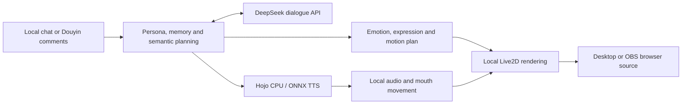

# Architecture and data flow

[简体中文](ARCHITECTURE.zh-CN.md) | [English](ARCHITECTURE.en.md) | [AI-Cartoon-Live](../README.md)

`main.cjs` owns Electron windows, key protection and startup. `supervisor.py` manages local services and data. `source/repo/src/local_*` handles persona, memory, performance and streaming. `source/hojo-*` handles CPU speech, and `stage/live2d` holds the character and renderer.

The default has one local character. An emotion plan accompanies the answer and is executed by the local controller. This combines available expressions and motions; it is not arbitrary-motion or cloud-video generation. Naturalness depends on context, the language model, rigging and voice.

Inherited source includes Vidu/RTC compatibility modules, but the desktop configuration disables Vidu and its UI uses the local route. These modules are not service dependencies of the default flow. DeepSeek generates dialogue; audio does not go to an external TTS service.
