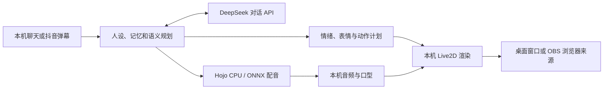

# 架构与数据流

[简体中文](ARCHITECTURE.zh-CN.md) | [English](ARCHITECTURE.en.md) | [AI-Cartoon-Live](../README.md)

`main.cjs` 管理 Electron 窗口、密钥保护和启动流程；`supervisor.py` 管理独立本机服务与数据目录；`source/repo/src/local_*` 负责角色、记忆、表演和直播；`source/hojo-*` 负责 CPU 配音；`stage/live2d` 提供角色与渲染器。

默认只有一个本机角色。情绪计划与回答一起产生，再通过本机表情控制器执行；它是有限动作与表情的组合，并非任意动作生成或云端视频生成。实际自然度取决于模型、语境、角色绑定和音色。

沿用的源代码含上游 Vidu/RTC 兼容模块，但本桌面版配置禁用 Vidu，UI 使用本地角色路线。它们不是默认流程的服务依赖。聊天由 DeepSeek 提供，语音不发送至第三方 TTS。
